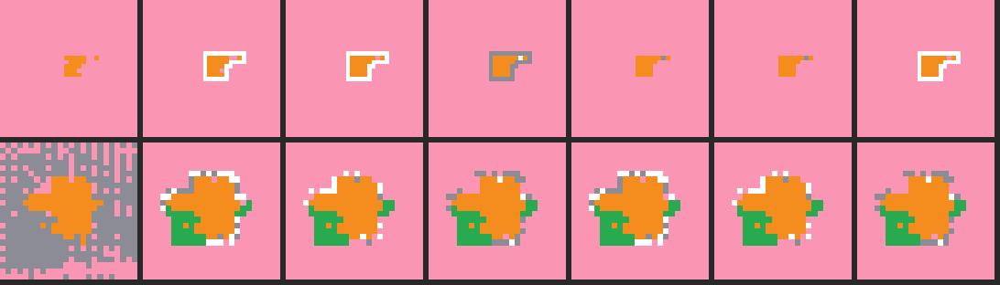
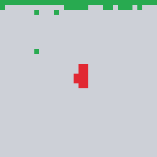
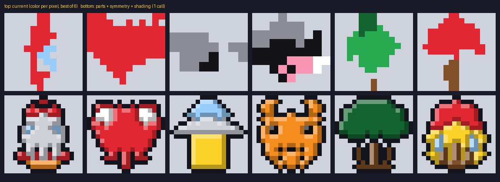

# PixelDrex

> **GIFs made entirely of decisions.** Drex can't draw — it only answers multiple-choice questions. So we made every pixel a question, and turned the answers into animated GIFs.

Built at **Drexathon** (Nace AI, Nov 14 2026) · Track: 🎨 Wildcard

🎥 **Backup demo video (2½ min):** [`docs/video/pixeldrex_demo.mp4`](docs/video/pixeldrex_demo.mp4) — live runs of the web app: a forest fire (replayed world), a wildfire world built from this week's news, and a 32×32 rocket being painted part by part.

Two ways a decision model makes a GIF:

- **🎬 Paint it (Scenes)** — type an idea; Drex decides which part of each 32×32 sprite covers every pixel, what color each part is, and how everything moves. 512 px GIFs.
- **🧬 Let it live (Drex Life)** — every pixel is a living agent. You describe a world; its laws of physics are plain English; every frame, every pixel asks Drex what it becomes next.

Everything else picks or fixes what the GIF shows: **this week's news** (Keenable) or **any document** (NDI) can define a world, and in **god mode** Intern rewrites a dull world's rules until the GIF comes alive.

## 🧬 Let it live: Drex Life

<p>


</p>

*Left: "a forest fire: lightning starts fires, fire spreads through trees, burnt ground slowly regrows" — lightning strikes, ragged glowing fire fronts spread, burnt ground regrows to grass and then forest, and new fires keep breaking out, so the world cycles instead of ending. Right: "a zombie outbreak in a city" — the infection spreads in glowing waves and the city turns over.* Nobody animated either one. Replay these exact worlds with `pixeldrex life --world worlds/forest-fire-cycle.json` (or `zombie-outbreak-city.json`).

```bash
.venv/bin/pixeldrex life "a zombie outbreak in a city"
```

1. A **director** LLM (DeepInfra) designs the world: 3–5 cell states with colors, 3–6 rules in plain English, and a starting layout. It never decides a single cell.
2. **Drex seeds the world**: one `choice` question per cell (32×32 = 1,024 questions).
3. **Every step, every cell asks Drex**: *"This cell is currently a tree. Of its 8 neighbours: 5 tree, 2 fire, 1 ash. Following the rules, what is this cell in the next step?"*
   - **Cells in the same situation share one question**, and Drex's answers are **cached across steps** — the world learns its physics from Drex as it goes. The forest fire made **17,280 cell decisions from 191 unique questions** (15 s, $0.004); by the end, each step needed about one new question.
   - The next state is **sampled from Drex's calibrated probabilities**, so "lightning *rarely* strikes" and "ash *slowly* regrows" really are rare and slow. Randomness in the world *is* Drex's uncertainty.
   - If the rules mention directions (sand *falls*, wind blows *east*), cells see which neighbour is where; otherwise only neighbour counts matter, which collapses far more cells into one question.
4. **Rendering** (Drex decides every state; this only decides how a state looks): beveled tiles with a little per-cell texture, a warm glow on cells that just changed (fading over 2 steps) so fire fronts and infection waves light up, and a blended in-between frame for smoother motion.

| World | Grid × steps | Cell decisions | Unique Drex questions | Time | Drex cost |
|---|---|---|---|---|---|
| Forest fire (gallery) | 32×32 × 40 | 41,984 | 1,832 | 22 s | $0.015 |
| Zombie outbreak (gallery) | 32×32 × 40 | 41,984 | 1,350 | 26 s | $0.012 |
| Forest fire (earlier, 24×24) | 24×24 × 30 | 17,280 | 191 | 15 s | $0.004 |

Worlds are designed fresh on every run, so results vary: some runs freeze, burn out or turn to noise. The gallery shows the best runs, and `worlds/` keeps their rules for replay.

### 😇 God mode: Intern rewrites the laws of physics

```bash
.venv/bin/pixeldrex god "a coral reef: coral grows, warm water bleaches coral, fish help bleached coral recover"
```

[Intern](https://github.com/nace-ai/intern), Nace's coding agent, becomes the god of a Drex Life world. It runs the world
(`pixeldrex life --world worlds/<name>.json --report`), reads the report, and if a state died out, the world froze,
or one state took over, it **edits the English rules in the world file** and runs it again — up to 4 times.
Two Drexes are at work: one decides every cell of the universe; the other, as Intern's System 1, supervises the god.


*Top: the director's original rules — a coral blob drips down and the world dies. Bottom: after Intern's 3 rewrites
(fish that can come back on their own, density-based neighbour counts, overcrowding that causes bleaching) — a living
reef where coral spreads, bleaches and recovers, and a school of fish moves through. 4 world runs, 12 Intern turns,
128 s, 29 System 1 (Drex) asks; the full agent log is in `intern_logs/`.*

### 📄 Any document becomes a world (NDI)

```bash
.venv/bin/pixeldrex life --doc docs/samples/coral_reef_field_notes.pdf --save-world worlds/reef.json
.venv/bin/pixeldrex god --world worlds/reef.json      # optional: let Intern fix the physics
```

[NDI](https://console.nace.ai) (Nace Document Intelligence) reads a PDF — a public URL or a local file it uploads, scanned
pages included (OCR) — and **Extract** fills a schema with the document's *actors* and *interactions* (what spreads to,
turns into, kills or helps what, and how fast), each **with citations to the page it came from**. The director turns
those facts into states and rules, and **every rule ends with its source page**:

```text
coral with warm neighbour becomes bleached (p. 1)
rock with coral neighbour becomes coral (p. 1)
rock with seaweed neighbour becomes seaweed (p. 2)
```

In god mode, Intern keeps the document's rules and citations, and tags every law it invents with `(god)` — so each
law of the final world says whether it came from the document or from the god. The sample is a 2-page,
scanned-style field report (`scripts/make_sample_doc.py`); NDI read it in ~18 s and put each fact on the right page.



*Top: the world built straight from the field notes froze (a heat patch flickers; the rules were written from the wrong cell's point of view). Bottom: after Intern's rewrites (it also deleted a rule about parrotfish, a state that did not exist) coral recolonises the rock and seaweed takes over the heat-damaged patch — the "phase shift" the notes describe. Intern reported honestly that it narrowly missed its own activity target (185 of 192 changed cells).*


### 📰 This week's news becomes a world (Keenable)

```bash
.venv/bin/pixeldrex life --news "bird flu"
```

[Keenable](https://keenable.ai) searches the last 7 days of news on the topic and reads the top articles in full (its
keyless public endpoints; set `KEENABLE_API_KEY` to use a key). The director turns the reporting into states and rules,
and **every rule cites the articles it came from**. In the web app, tick *"Build the world from this week's news"* in
Drex Life mode and the linked headlines appear under the rules.

<p>


</p>

*Left, "bird flu" on Nov 14 2026: five UK reports (outbreaks near Dereham and Dersingham, a national housing order)
→ `healthy with infected neighbour becomes infected [1, 2, 3]`, `infected becomes culled [2, 3]`,
`healthy with protected neighbour becomes protected [1, 4]` → rings of infection and culling while the protected zone
spreads. Right, "wildfire": reporting on New Hampshire's Wild River Fire → `forest with a fire neighbour often becomes
fire [2, 3]`, `fire with a rain neighbour rarely becomes ash [1, 4]`.*

## 🎬 Paint it: scenes

<p>


</p>

You type an idea. The director turns it into a scene spec (background, up to 3 sprites with their parts, how each moves). Then every visual decision is made by [Drex](https://console.nace.ai), Nace's decision model, on a 64×64 canvas:

1. **Background** — every pixel of a 16×16 grid is one `choice` question over a 15-color palette, plus 16 "which color covers most of row r?" questions, all in **one** request. Each pixel takes the argmax of P(pixel) × P(row)^0.5, so calibrated row answers fill in areas the pixel answers are unsure about. Then it is enlarged to 32×32 and Drex smooths its edges (below).
2. **Sprite — the right question.** Not "what color is pixel (8, 12)?" but **"which part of the rocket covers pixel (8, 12): nose cone, body, window, fins, flame or empty?"** — plus "what color is the nose cone?" for each part, all in **one** request. The director names each sprite's parts; symmetric sprites (rockets, UFOs, faces, trees) ask only the left half and mirror it. Each part is one solid color, shaded like pixel art (lit top-left edges, shadowed bottom-right) with an outline.



*Top: asking for a color per pixel (best of 6 candidates). Bottom: asking which part covers each pixel — one call per sprite, 6 sprites in 2.5 s.*

**32×32 sprites — local questions, not coordinates.** Asking about 32 rows directly gets noisy (Drex is good at local
judgments, weak at exact positions), and a 16×16 guide image didn't help — Drex reinterpreted it. What works is the trick
Drex Life uses: paint the clean 16×16 shape, enlarge it to 32×32, then let **every edge pixel ask Drex** *"I'm 'body';
north: nose cone, east: empty, … which should I be so the outline is smooth?"* — no coordinates, identical neighbourhoods
share one question, ~1 call per sprite. Backgrounds are smoothed the same way. Scenes are now a 64×64 canvas with 32×32
sprites, rendered at 512 px.


*Top: 16×16. Bottom: the same shapes at 32×32, every edge pixel decided by Drex from its neighbourhood (6 sprites, 3.1 s).*

3. **Motion** — one request per sprite asks "where is it, and how big, in each of 16 frames?" as `score` questions. Scores are **expected values**, so the motion comes out sub-pixel smooth.

5–8 Drex calls · 5–9 s · < 1¢ per 512 px GIF. Nobody told the rocket to shrink as it flies away — Drex decided that. Front-view sprites come out best; side-view animals are still blobby.

```text
$ pixeldrex "a ufo abducting a cow at night"
  [  4.4s] director: 'UFO Abducts Cow' with 2 sprite(s): UFO, Cow
  [  6.6s] background painted (256 pixel decisions)
  ...
  GIF: out/gallery/20261114-210009-ufo-abducts-cow/anim.gif
  1,046 Drex decisions in 8 calls · 8.9s total · Drex ≈ $0.0085 · director $0.00010
```

Options: `--frames N`, `--ms N`, `--no-outline`, `--spec-only` (show the director's plan), `--spec FILE` (re-paint a saved plan), `--json`.

## Quick start

```bash
python -m venv .venv && .venv/bin/pip install -e .
cp .env.example .env   # add NACE_API_KEY (console.nace.ai) and DEEPINFRA_API_KEY
.venv/bin/pixeldrex life "a forest fire"        # Drex Life (a fresh world)
.venv/bin/pixeldrex life --world worlds/forest-fire-cycle.json   # replay a known-good world
.venv/bin/pixeldrex "a rocket launching at night" # a scene
.venv/bin/pixeldrex-web                         # web app on http://127.0.0.1:8000
```

The web app has both modes. In **Drex Life** you can describe a new world, build one from this week's news, or **replay a saved world** (one click, known-good rules, fresh Drex decisions), and watch it evolve frame by frame as Drex decides it, with live population bars for each state, the rules, and counters for cell decisions vs unique Drex questions. In **Scene** you see the director's plan, each layer as it's painted, the motion paths Drex chose, and live decision/cost counters. Everything lands in the gallery.

## Layout

| Path | What |
|---|---|
| `pixeldrex/drex.py` | Async Drex client: typed questions, images, 8-in-flight limit, retries, cost/latency tracking |
| `pixeldrex/life.py` | Drex Life: world design, seeding, per-situation questions with caching, probabilistic steps |
| `pixeldrex/god.py` | God mode: Intern tunes a world's rules until it stays alive |
| `pixeldrex/ndi.py` | NDI: upload or link a document, Extract actors and interactions with page citations, build a cited world |
| `docs/samples/` | A 2-page scanned-style field report for the NDI demo |
| `pixeldrex/news.py` | Keenable: search this week's news and read the top articles; build a world whose rules cite them |
| `scripts/intern.sh`, `intern_logs/` | Run Intern headless on this repo; every Intern run's JSON events and reply |
| `worlds/` | Saved worlds (rules in English) |
| `pixeldrex/parts.py` | Sprites from part questions ("which part covers this pixel?"), symmetry, shading, and Drex edge smoothing to 32×32 |
| `pixeldrex/pixels.py` | Scene engine: background fusion, motion, compositing (64×64 canvas, 512 px GIFs), plus the earlier color-per-pixel painter |
| `pixeldrex/director.py` | Scene director: idea → scene spec JSON (DeepInfra LLM) |
| `pixeldrex/llm.py` | DeepInfra client: chat, vision, FLUX images |
| `pixeldrex/cli.py` | The `pixeldrex`, `pixeldrex life` and `pixeldrex god` commands; saves GIFs, frames, specs and stats to `out/gallery/` |
| `pixeldrex/web.py`, `pixeldrex/web/index.html` | The web app (FastAPI + server-sent events): scenes, Drex Life, news worlds, saved-world replay |
| `scripts/` | Experiments (parts vs colors, 16 vs 32, v1 per-frame painting, large images, background fusion, Life demos) and the demo-video builder |
| `docs/deck/` | The pitch deck: built from the real runs (`build_assets.py`, `build_deck.py`) and imported into Adobe Express |
| `docs/video/` | The backup demo video |
| `docs/SUBMISSION.md` | The Drexathon submission text |
| `bench/` | Side experiment: Drex vs LLMs writing pixel grids as text |
| `PLAN.md` | The build plan written at 11:00 (this README describes what was actually built) |

## License

MIT
