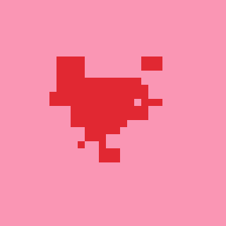

# PixelDrex

> **Every pixel is a decision.** Drex can't draw — it only answers multiple-choice questions. So we made every pixel a question.

Built at **Drexathon** (Nace AI, Nov 14 2026) · Track: 🎨 Wildcard

Two things you can do with it:

- **🧬 Drex Life** — every pixel is a living agent. You describe a world; the laws of physics are written in plain English; every step, every cell asks Drex what it becomes next.
- **🎬 Scenes** — type an idea; Drex paints every pixel of the background and sprites and decides how everything moves.

## 🧬 Drex Life

<p>


</p>

*Left: "a forest fire: lightning starts fires, fire spreads through trees, burnt ground slowly regrows" — lightning strikes, a burning front spreads as a ring, ash follows, trees regrow in the burn scar, and a second strike starts the next wave. Right: "a zombie outbreak in a city" — a human city grows, zombies creep in from the corners and take it.* Nobody animated either one.

```bash
.venv/bin/pixeldrex life "a zombie outbreak in a city"
```

1. A **director** LLM (DeepInfra) designs the world: 3–5 cell states with colors, 3–6 rules in plain English, and a starting layout. It never decides a single cell.
2. **Drex seeds the world**: one `choice` question per cell (32×32 = 1,024 questions).
3. **Every step, every cell asks Drex**: *"This cell is currently a tree. Of its 8 neighbours: 5 tree, 2 fire, 1 ash. Following the rules, what is this cell in the next step?"*
   - **Cells in the same situation share one question**, and Drex's answers are **cached across steps** — the world learns its physics from Drex as it goes. The forest fire made **17,280 cell decisions from 191 unique questions** (15 s, $0.004); by the end, each step needed about one new question.
   - The next state is **sampled from Drex's calibrated probabilities**, so "lightning *rarely* strikes" and "ash *slowly* regrows" really are rare and slow. Randomness in the world *is* Drex's uncertainty.
   - If the rules mention directions (sand *falls*, wind blows *east*), cells see which neighbour is where; otherwise only neighbour counts matter, which collapses far more cells into one question.

| World | Grid × steps | Cell decisions | Unique Drex questions | Time | Drex cost |
|---|---|---|---|---|---|
| Forest fire | 24×24 × 30 | 17,280 | 191 | 15 s | $0.004 |
| Zombie outbreak | 32×32 × 40 | 40,960 | 590 | 17 s | $0.008 |

## 🎬 Scenes

<p>




</p>

You type an idea. The director turns it into a scene spec (background, up to 3 sprites, how each moves). Then every visual decision is made by [Drex](https://console.nace.ai), Nace's decision model:

1. **Background** — every pixel of a 16×16 grid is one `choice` question over a 15-color palette, plus 16 "which color covers most of row r?" questions, all in **one** request. Each pixel takes the argmax of P(pixel) × P(row)^0.5, so calibrated row answers fill in areas the pixel answers are unsure about.
2. **Sprite** — painted in 3 phrasings; extra variations are *sampled from Drex's own per-pixel probabilities* (no extra calls); stray pixels are cleaned; Drex Max looks at all 6 candidates and picks the best. Trimmed and given a 1-px outline.
3. **Motion** — one request per sprite asks "where is it, and how big, in each of 16 frames?" as `score` questions. Scores are **expected values**, so the motion comes out sub-pixel smooth.

≈ 6 Drex calls · ≈ 1,100 decisions · ~5 s · < 1¢ per single-sprite GIF. Nobody told the rocket to shrink as it flies away — Drex decided that.

```text
$ pixeldrex "a ufo abducting a cow at night"
  [  2.6s] director: 'UFO Abducts Cow' with 2 sprite(s): UFO, Cow
  [  3.6s] motion for 'UFO' decided: (15,6) -> (15,6), size 15 -> 15
  [  3.7s] motion for 'Cow' decided: (15,26) -> (15,5), size 13 -> 13
  [  5.9s] background painted (256 pixel decisions)
  [  6.5s] sprite 'UFO' painted 3 ways, judged best of 6
  [  7.1s] sprite 'Cow' painted 3 ways, judged best of 6
  [  7.1s] composited 16 frames

  GIF: out/gallery/20261114-192020-ufo-abducts-cow/anim.gif
  1,890 Drex decisions in 11 calls · 7.1s total · Drex ≈ $0.0131 · director $0.00005
```

Options: `--frames N`, `--ms N`, `--no-outline`, `--spec-only` (show the director's plan), `--spec FILE` (re-paint a saved plan), `--json`.

## Quick start

```bash
python -m venv .venv && .venv/bin/pip install -e .
cp .env.example .env   # add NACE_API_KEY (console.nace.ai) and DEEPINFRA_API_KEY
.venv/bin/pixeldrex life "a forest fire"        # Drex Life
.venv/bin/pixeldrex "a rocket launching at night" # a scene
.venv/bin/pixeldrex-web                         # web app on http://127.0.0.1:8000
```

The web app has both modes. In **Drex Life** you watch the world evolve frame by frame as Drex decides it, with live population bars for each state, the rules, and counters for cell decisions vs unique Drex questions. In **Scene** you see the director's plan, each layer as it's painted, the motion paths Drex chose, and live decision/cost counters. Everything lands in the gallery.

## Layout

| Path | What |
|---|---|
| `pixeldrex/drex.py` | Async Drex client: typed questions, images, 8-in-flight limit, retries, cost/latency tracking |
| `pixeldrex/life.py` | Drex Life: world design, seeding, per-situation questions with caching, probabilistic steps |
| `pixeldrex/pixels.py` | Scene engine: paint, background fusion, sample, judge, refine, tiled painting, motion, compositing |
| `pixeldrex/director.py` | Scene director: idea → scene spec JSON (DeepInfra LLM) |
| `pixeldrex/llm.py` | DeepInfra client: chat, vision, FLUX images |
| `pixeldrex/cli.py` | The `pixeldrex` and `pixeldrex life` commands; saves GIFs, frames, specs and stats to `out/gallery/` |
| `pixeldrex/web.py`, `pixeldrex/web/index.html` | The web app (FastAPI + server-sent events) |
| `scripts/` | Experiments: scenes, v1 per-frame painting, large images, background fusion, Life demos |
| `bench/` | Side experiment: Drex vs LLMs writing pixel grids as text |
| `PLAN.md` | Build plan for the hackathon |

## License

MIT
