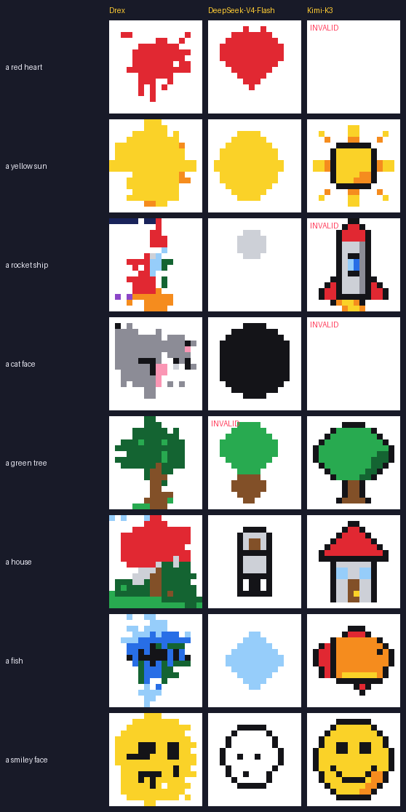

# Benchmark: a decision model vs LLMs painting 16×16 pixel art

**Question:** if every pixel is a multiple-choice decision, can Drex paint as well as LLMs that write the
pixel grid as text, and at what speed and cost?

**Setup** (`bench/run.py`, run on Nov 14 2026):
- 8 subjects: heart, sun, rocket ship, cat face, tree, house, fish, smiley face. Same 15-color palette for everyone.
- **Drex** (`drex-max-v1.1`): one request per image, 256 `choice` questions (one per pixel). No cleanup, no best-of.
- **LLMs on DeepInfra**: asked for the same grid as JSON (16 rows of 16 palette letters), `max_tokens` 16,000
  so reasoning models have room. Models: `deepseek-ai/DeepSeek-V4-Flash` (fast, cheap) and
  `moonshotai/Kimi-K3` (DeepInfra's most expensive frontier model).
- **Judge**: `Qwen/Qwen3-VL-235B-A22B-Instruct`, blind pairwise "which is the clearer drawing of X?", shown
  **both orders**; a win needs both orders, anything else is a tie.
- Raw LLM outputs (with finish reasons and usage) are in `results/llm_raw_outputs.json`.

## Results

| | **Drex** | **DeepSeek-V4-Flash** | **Kimi-K3** |
|---|---|---|---|
| Drew the subject (valid, non-blank grid) | **8 / 8** | 7 / 8 valid; rocket, cat, fish are generic blobs | 5 / 8 (1 hit our 120 s request timeout, 1 hit 16k tokens, 1 malformed) |
| Seconds per image | median **3.5** (2 outliers ~12 s from retries) | **2.4** | 86 |
| $ per image | **0.0018** | **0.00004** | 0.096 |
| Blind judge vs Drex (Drex wins / LLM wins / ties) | – | 4 / 2 / 2 | 2 / 3 / 3 |

## Reading it honestly

- **Kimi-K3 draws the best pictures when it finishes** (sun, house, smiley beat Drex), but it is ~25× slower,
  ~55× more expensive, and failed 3 of 8.
- **DeepSeek-V4-Flash is the cheapest and fastest**, and its simple symmetric icons are clean, but it loses the
  subject on anything with structure (rocket → gray blob, cat face → black circle, fish → blue diamond).
- **Drex is the only one that always drew the actual subject**, with structure (tree with a trunk, house with
  grass, cat with ears), in a few seconds for a fraction of a cent. Its edges are noisier, which is what the
  engine's best-of-6 judging and cleanup fix in the real pipeline.
- Drex Max's cost is computed from its input tokens at $0.06 per million (output tokens aren't billed);
  LLM costs are DeepInfra's reported `estimated_cost`.
